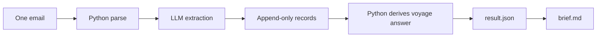
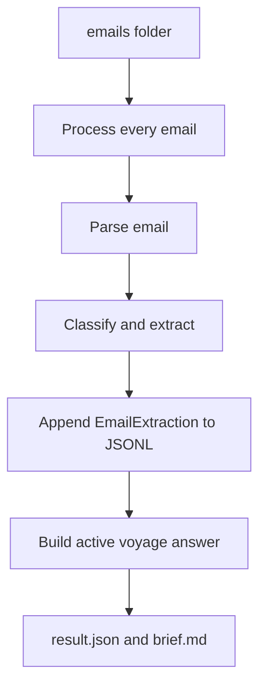
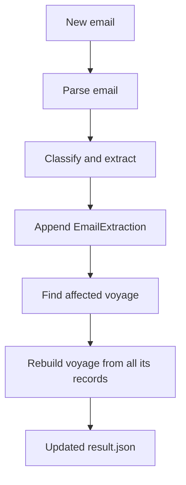
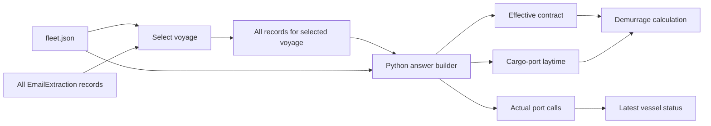
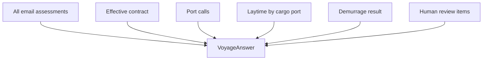

# Demurrage pipeline architecture

## 1. Goal

Run the pipeline on a folder of emails and answer, for each active voyage:

1. Which emails matter, which vessel and voyage they concern, and whether they
   affect schedule or laytime.
2. The effective contract terms.
3. Arrival and sailing time for every port call.
4. Laytime start, end, deductions, and used time at each cargo port.
5. Total laytime, excess time, and demurrage owed.
6. The email evidence behind every important date, time, and number.
7. Anything uncertain or contradictory that a person should review.

The pipeline writes:

- `extractions.jsonl`: one structured extraction per email;
- `result.json`: the complete machine-readable voyage answer;
- `brief.md`: a one-minute operator summary made from `result.json`.

## 2. Main design rule

The LLM reads one email at a time. It classifies the email and extracts
structured facts with exact quotations.

Python owns everything after extraction: storage, source precedence, time-zone
normalization, laytime arithmetic, demurrage arithmetic, validation, and output.
An LLM never maintains or mutates voyage state.



This separation keeps language interpretation flexible and financial
calculations deterministic and testable.

## 3. Two operating modes

Both modes use the same parser, extraction schema, and Python answer builder.

### 3.1 Batch recording

Batch mode imports the supplied folder or rebuilds the records from scratch.



Rules:

- Process each file independently.
- Save one validated `EmailExtraction` per line.
- Build the answer after all emails have been recorded.
- Load all recorded extractions associated with the active voyage when building
  its answer.
- Do not rely on filename or email arrival order.
- Re-running the same folder should produce the same logical answer.

### 3.2 Live extraction

Live mode handles an email arriving after the initial batch.



Rules:

- Append the new extraction; do not ask the LLM to edit an old state object.
- Find the affected voyage, load all extractions associated with that voyage,
  and rebuild its complete answer.
- If the voyage association is uncertain, retain the record and create a
  review item instead of forcing a match.

## 4. Parse and extract one email

### 4.1 Python parsing

The parser preserves:

- stable source ID;
- original filename and content hash;
- `Message-ID`, `In-Reply-To`, and `References`;
- sender, recipients, subject, and email sent time;
- decoded body text;
- quoted or forwarded sections where practical;
- parse warnings.

The email sent time is not an operational event time.

### 4.2 Structured LLM extraction

Use one structured call with logical gates:

1. Is this about a voyage: `yes`, `no`, or `uncertain`?
2. Which fleet vessel and voyage?
3. Does it concern contract terms, schedule/port calls, laytime, position, or
   another topic?
4. For each applicable topic, return typed facts with exact source quotations.

```text
EmailExtraction
├── source_id and message metadata
├── vessel and voyage assessment
├── relevance: relevant / not relevant / uncertain
├── affects_schedule
├── affects_laytime
├── topic flags
├── contract_facts[]
├── port_events[]
├── stoppages[]
├── position_facts[]
└── warnings[]
```

Each extracted fact includes:

- a typed value;
- its unit or time-zone label where applicable;
- actual, estimated, interim, final, corrected, or unknown status;
- the exact supporting quote;
- source ID.

A port event additionally includes the event type, port, raw time expression,
and whether the value is actual or estimated.

The model extracts what an email says. It does not calculate durations, choose
between conflicting emails, or invent missing values.

## 5. Build the voyage answer in Python

`fleet.json` supplies vessel identity, the active voyage, planned ports, their
order, and whether a call is load, discharge, or another function.

The recorded extractions supply what was reported to have happened.

For this version, the dataset is small enough to load **all** extractions
associated with the selected voyage. There is no separate retrieval or ranking
stage that tries to choose a smaller evidence pack. Python filters records by
their voyage association, then builds the answer from the complete set.

This keeps the first implementation simple and prevents a retrieval step from
silently omitting a material recap, addendum, SOF, or correction.



### 5.1 Selection rules

Keep the first implementation small and explicit:

- A clean recap supplies the baseline contract.
- An addendum replaces only the term it explicitly changes.
- Actual events beat estimates.
- A final SOF beats an interim SOF and ordinary notices for events in its port.
- An interim SOF may support a provisional answer before the final SOF arrives.
- Equivalent UTC and local times corroborate one another; they are not a
  conflict.
- Equal-authority sources that still disagree remain conflicted.
- A non-cargo call remains in the voyage timeline but does not count for
  laytime.
- Email delivery order never decides which value wins.
- Losing and superseded evidence remains visible for audit.

## 6. Final output

The public output is `VoyageAnswer`, serialized as `result.json`.



```text
VoyageAnswer
├── voyage
├── emails[]
├── contract
├── port_calls[]
├── laytime_by_cargo_port[]
├── latest_position
├── demurrage
├── review_items[]
└── evidence_index[]
```

### 6.1 Voyage

- voyage ID;
- vessel name and IMO;
- charterer;
- final, provisional, or incomplete answer status.

### 6.2 EmailAssessment

There is one entry for every processed email, including irrelevant messages:

- source ID and subject;
- matched vessel and voyage, if any;
- relevant, not relevant, or uncertain;
- affects schedule: yes/no;
- affects laytime: yes/no;
- topic flags;
- short reason.

### 6.3 ContractTerms

Include every input required by the calculator:

- laytime allowance;
- reversible or non-reversible;
- turn time after NOR;
- event that ends laytime;
- demurrage rate, currency, and pro-rata treatment;
- deduction/counting rules;
- whether exceptions continue on demurrage;
- amendment history and evidence.

### 6.4 PortCall

For every planned or discovered call:

- stable port-call ID;
- port and function;
- EOSP/arrival;
- sailing/departure;
- whether laytime applies;
- final, provisional, missing, or conflicted status;
- evidence.

### 6.5 CargoPortLaytime

For every load or discharge call:

- NOR tendered;
- calculated laytime start;
- final hoses disconnected;
- gross duration;
- each stoppage and applied contract rule;
- deducted duration;
- used duration;
- calculation notes and evidence;
- final, provisional, missing, or conflicted status.

### 6.6 DemurrageAnswer

- aggregation method;
- total used laytime;
- allowed laytime;
- excess time;
- daily rate and currency;
- amount owed;
- calculation formula;
- final, provisional, or incomplete status;
- evidence for all contract inputs.

### 6.7 EvidenceRef

Every material date, time, duration, rate, and amount links to:

- source ID;
- exact quote;
- optional text offsets;
- optional note describing a derived value.

Derived values link to the evidence for their inputs. For example, laytime start
links to the NOR event and the contractual turn time.

### 6.8 ReviewItem

- blocker, material, or advisory severity;
- stable issue code;
- plain-language message;
- affected result fields;
- related source IDs.

## 7. Calculation

Use timezone-aware datetimes and integer seconds internally.

```text
laytime start = NOR tendered + contractual turn time
laytime end = final hoses disconnected
used per port = end - start - deductions

if reversible:
    total used = sum(used time at cargo ports)

excess = max(total used - allowance, 0)
amount owed = excess hours / 24 × daily demurrage rate
```

Clip stoppages to the laytime window. If stoppages overlap, split the timeline
so the same elapsed time is not deducted twice. Round money only in the final
output.

The answer is final only when every cargo port has final hose-disconnection
evidence and every required contract input is resolved.

## 8. Operator brief

Generate `brief.md` from the validated `VoyageAnswer`.

It contains:

- latest supported vessel position or status;
- port arrivals and departures;
- used laytime by cargo port;
- total used versus allowed;
- demurrage rate and amount;
- final/provisional label;
- material human-review items.

The brief must copy numeric values from `result.json`; it must not recalculate
them.

## 9. Testing

### 9.1 Parser tests

- All 19 emails parse.
- Stable IDs do not change between runs.
- A forwarded or quoted message remains identifiable.
- Email sent time is not used as an event time.

### 9.2 Extraction tests

Use reviewed examples covering:

- relevant voyage email;
- irrelevant invoice;
- similar fleet vessel name;
- vessel outside the fleet;
- clean recap;
- addendum;
- final SOF;
- forwarded duplicate;
- interim/final correction;
- UTC/local descriptions of the same event.

For every extracted fact, verify that its evidence quote occurs in the source
email.

### 9.3 Derivation and calculation tests

- Addendum rate replaces the recap rate only.
- Final SOF replaces the interim event value.
- UTC/WAT equivalent values resolve to the same instant.
- Non-cargo calls do not contribute laytime.
- Contract count factors produce the expected deductions.
- Reversible port totals and pro-rata money are exact.
- Equal-authority disagreement creates a review item.
- Shuffling email files does not change the final answer.
- Duplicating a forwarded message does not change the final answer.

### 9.4 End-to-end fixture

The reviewed 19-email fixture should produce:

| Field | Expected value |
|---|---:|
| Emails assessed | 19 |
| Antwerp used laytime | 38.0 h |
| Cotonou used laytime | 95.5 h |
| Total used laytime | 133.5 h |
| Excess laytime | 61.5 h |
| Demurrage amount | USD 65,343.75 |
| Answer status | final |

## 10. Evaluation

Evaluate extraction separately from Python calculation.


### 10.1 Golden set

Keep reviewed examples for the difficult cases:

- KESTREL BAY versus KESTREL POINT;
- irrelevant Antwerp invoice;
- ALDER STAR outside the fleet;
- forwarded duplicate;
- recap plus rate addendum;
- master UTC versus agent WAT;
- interim versus final Cotonou SOF.

### 10.2 Metrics

Measure:

- vessel and voyage association accuracy;
- relevance and topic precision/recall;
- fact accuracy by type: contract, event, stoppage, position;
- percentage of evidence quotes found exactly in source text;
- conflict/correction detection;
- end-to-end answer field accuracy;
- token usage, latency, and cost per 19-email run.

Accept a model or prompt change only when:

- the golden extraction set does not regress;
- all evidence quotes validate;
- the end-to-end calculation still matches the reviewed fixture;
- any cost increase is justified by better accuracy.

## 11. Build order

1. Define `EmailExtraction` and `VoyageAnswer`.
2. Parse `.eml` files.
3. Implement one-email extraction.
4. Record all 19 extractions.
5. Build the Python voyage answer.
6. Calculate laytime and demurrage.
7. Write `result.json` and `brief.md`.
8. Add tests and record evaluation results.

## 12. Deferred work

Do not include these in the first implementation:

- mutable LLM-maintained contract or voyage state;
- voyage-level resolver agent;
- multi-agent orchestration;
- granular retrieval by port, event type, or time window;
- database, queues, vector store, API, or UI;
- full relationship or decision graph;
- generic support for every charter-party clause.

For a production inbox, local JSONL could later be replaced by indexed storage
and selective retrieval. That optimization must preserve voyage-level
completeness and the same extraction and output contracts.
