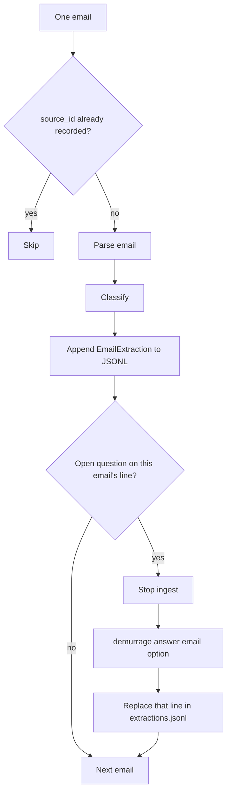
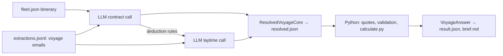
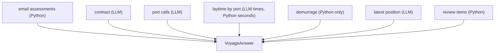

# Demurrage pipeline architecture

## 1. Goal

Run the pipeline on a folder of emails and answer, for each active voyage:

1. Which emails matter, which vessel and voyage they concern, and whether they
   affect schedule or laytime.
2. The effective contract terms.
3. Arrival and sailing time for every port call.
4. Laytime start, end, deductions, and used time at each cargo port.
5. Total laytime, excess time, and demurrage owed.
6. The email evidence behind every important date, time, and number.
7. Anything uncertain or contradictory that a person should review.

The pipeline writes:

- `extractions.jsonl`: one structured extraction per email;
- `result.json`: the complete machine-readable voyage answer;
- `brief.md`: a one-minute operator summary made from `result.json`.

## 2. Main design rule

**LLMs choose, Python calculates.** There are two LLM jobs, and neither of
them produces a number that Python can compute:

1. **Classification** reads one email at a time with three Jev choice calls
   (about a voyage? which fleet vessel? which topics?). It extracts no facts.
2. **Resolution** runs on demand for one voyage, in **two structured calls**
   over the full bodies of that voyage's emails:
   - the **contract call** reads the emails classified as contract and returns
     `ContractTerms` (including deduction rules);
   - the **laytime call** reads the other voyage emails plus those deduction
     rules and returns `port_visits[]`, `laytime_by_cargo_port[]` and
     `latest_position`.

   Every value is backed by an `EvidenceRef` that cites **line numbers** in an
   email body. The model never retypes the email text; Python copies the cited
   lines into `quote` (section 6.7).

**The model does no arithmetic.** It copies values as the email writes them
and makes judgement calls (which report wins, which rule applies). Every
conversion and calculation is Python's (section 5.2).

Python owns everything else: storage, quote filling and validation, **laytime duration
seconds** on each cargo port, **demurrage**, `emails[]`, `voyage`, review items,
and writing `result.json`. Demurrage is never an LLM output. Duration seconds
on laytime rows are computed in Python (section 7), not returned by the
resolver. An LLM never edits stored records and never computes money owed.

```mermaid
flowchart LR
    Email["One email"] --> Parse["Python parse"]
    Parse --> Extract["LLM classification"]
    Extract --> Records["extractions.jsonl"]
    Records --> Contract["LLM contract call"]
    Contract --> Laytime["LLM laytime call: ports, laytime, position"]
    Laytime --> Quotes["Python: quotes from cited lines, validation"]
    Quotes --> Calculate["Python: durations, demurrage"]
    Calculate --> Result["result.json"]
    Result --> Brief["brief.md"]
```



Language judgment (which of several reported values counts) goes to a model,
where fixed rules would break on unseen wording. Financial arithmetic stays
deterministic and testable.

## 3. One ingestion step, two entry points

There is a single per-email step. Live mode runs it on new emails; batch mode
clears the records and runs it on every email in the folder.



- **Live** (`demurrage live [paths]`): ingest the given emails, or every email in
  `emails/` that is not yet recorded.
- **Batch** (`demurrage batch`): delete `extractions.jsonl`, `resolved.json`,
  `result.json` and `brief.md`, then run live on the whole folder, reusing
  earlier human answers.
- **Report** (`demurrage report <voyage number or vessel name>`): resolve that
  voyage from the recorded extractions and write `result.json` and `brief.md`.
  Ingest never calls the resolver; only `report` does.
- **Check** (`demurrage check`): re-run every validation on the saved outputs.

Rules:

- Process each file independently.
- Save one validated `EmailExtraction` per line, at most one per `source_id`;
  re-ingesting an already-recorded email is a no-op.
- Append the new extraction; do not ask the LLM to edit an old state object.
- Do not rely on filename or email arrival order: the answer must not depend
  on it.
- Re-running the same folder should produce the same logical answer.
- If the voyage association is uncertain, retain the record and create a
  review item instead of forcing a match.

### 3.1 Human questions

After extraction, Python checks each email for anything only a human can
decide (for example `VESSEL_UNCERTAIN`: which fleet vessel the email is about).
If so, the email's line in `extractions.jsonl` carries a `review` with the
question, the allowed options and `status: open`.

Ingest is sequential: while any line has an open review, no further email is
processed. The operator answers with
`demurrage answer <filename or source_id> <option>`. That **same line is
replaced** with `review.status: answered`, the chosen option and a timestamp;
no new line is added. Ingest then resumes until the next question or the end.

The model's extracted values stay untouched on the line; Python applies the
human answer when building the voyage answer, and the answer always wins.
`demurrage batch` keeps answered reviews: if the rebuilt extraction raises the
same question for the same `source_id`, the earlier answer is reused instead of
asking again.

## 4. Parse and extract one email

### 4.1 Python parsing

The parser preserves:

- stable source ID;
- original filename and content hash;
- `Message-ID`, `In-Reply-To`, and `References`;
- sender, recipients, subject, and email sent time;
- decoded body text;
- quoted or forwarded sections where practical;
- parse warnings.

The email sent time is not an operational event time.

### 4.2 LLM classification

Three Jev choice calls (`classify.py`), each stopping early on a clear "no":

1. Is this about a voyage: `yes`, `no`, or `uncertain`?
2. Which fleet vessel (or `uncertain` / `not_our_vessel`)?
3. For each topic (contract, schedule, laytime, position, other): `yes`, `no`,
   or `uncertain`.

Typed facts with evidence are a resolver step, not part of `EmailExtraction`.

```text
EmailExtraction
├── source_id and message metadata
├── vessel_name
├── voyage_about: yes / no / uncertain
├── topics: yes / no / uncertain per topic
├── affects_schedule, affects_laytime   (derived from topics)
├── extraction_status: pending / complete
├── review / answered_reviews
└── warnings[]
```

Classification does not calculate durations, choose between conflicting emails,
or invent missing values. Typed facts belong to the resolver.

## 5. Build the voyage answer: resolver core, then Python finish

`fleet.json` supplies vessel identity, the active voyage, planned ports, their
order, and whether a call is load, discharge, or another function.

The extractions decide which emails belong to the voyage (vessel matched,
`voyage_about: yes`, human answers applied). The resolver then reads the
**full body** of every one of those emails, each line numbered `N| text`.

For this version, the dataset is small enough to send **all** of the voyage's
emails. There is no separate retrieval or ranking stage that tries to choose a
smaller evidence pack. This keeps the first implementation simple and prevents
a retrieval step from silently omitting a material recap, addendum, SOF, or
correction.



The contract call returns `ContractDraft`, the laytime call `LaytimeDraft`.
Python merges them onto the itinerary skeleton (visit ids, ports and functions
always come from `fleet.json`) into `ResolvedVoyageCore`:

```text
ResolvedVoyageCore
├── contract: ContractTerms
├── port_visits: PortVisit[]
├── laytime_by_cargo_port: CargoPortLaytime[]   (times/stoppages; seconds null)
├── latest_position
├── questions[]   optional human questions if unsure
└── notes[]
```

There is no `demurrage` on this object. Python fills that when assembling
`VoyageAnswer`. `latest_position` comes from the laytime call: the report
with the latest `reported_at`, not the latest email sent time.

Before demurrage, Python copies each cited line range into `EvidenceRef.quote`
and validates the core (section 5.0). If validation fails, both calls are
retried once with the problems appended to the prompt; a second failure stops
the run. Python then fills `gross_duration_seconds` / `used_duration_seconds`
from timestamps and contract rules (section 7) and runs the demurrage formula.

The resolver is skipped, and the saved `resolved.json` reused, only when no
voyage email is flagged `yes` for contract, schedule, laytime, or position.

### 5.0 Validation at every stage

All schemas are Pydantic models (`models.py`, `extra="forbid"`). Each LLM call
asks for `Schema.model_json_schema()` and parses the reply with
`Schema.model_validate_json`, so malformed output fails at the call. Checks run
in two layers:

- **Inside a schema** (`model_validator`): rules that need only that object,
  such as `used = gross − deducted`, `excess = max(used − allowed, 0)`,
  `amount = excess / 86400 × rate`, and an answered review whose answer is one of
  its options.
- **Across stages** (`validate.py`): `validate_extraction` (the extraction's
  metadata matches the parsed email), `validate_resolved` (every itinerary
  visit present, one laytime row per cargo visit, no durations filled, every
  citation names a voyage email, its lines exist, and `quote` equals those
  lines; each stoppage's `deduction_rule` is a contract rule and its fraction
  is that rule's; every time equals what Python derives from its `*_written`
  value), `validate_answer` (laytime and demurrage recompute exactly), and
  `validate_brief`.

The pipeline raises `StageValidationError` at the first failing stage.
`demurrage check` re-runs every check on the saved `extractions.jsonl`,
`result.json` and `brief.md`.

### 5.1 Resolver instructions

These rules go into the resolver prompt and into its golden test set:

- A clean recap supplies the baseline contract.
- An addendum replaces only the term it explicitly changes.
- Actual events beat estimates.
- A final SOF beats an interim SOF and ordinary notices for events in its port.
- An interim SOF may support a provisional answer before the final SOF arrives.
- Equivalent UTC and local times corroborate one another; they are not a
  conflict.
- Equal-authority sources that still disagree remain conflicted.
- A non-cargo call remains in the voyage timeline but does not count for
  laytime.
- Email delivery order never decides which value wins.
- Losing and superseded evidence remains visible for audit.
- `latest_position` is the report with the latest `reported_at`. Email sent
  time is not used.
- SOFs and agents' notices are port local time; a master's report labelled
  UTC/GMT/Z is UTC. The model copies the clock and the label; it does not
  convert.

### 5.2 What the model reads, what Python derives (`derive.py`)

The model's schema contains only what can be read off the page. Every derived
field is hidden from it (`SkipJsonSchema`) and filled by Python:

| Model returns | Python fills |
| --- | --- |
| `arrival_written`, `nor_tendered_written`, `start_written`, … as `{value: "YYYY-MM-DDTHH:MM", basis: local / utc}` | `arrival`, `nor_tendered`, `start`, … in ISO 8601 with the port's `utc_offset` from `fleet.json`; a UTC time is converted to port local time |
| `laytime_allowance` + `laytime_allowance_unit` (hours / days) | `laytime_allowance_hours` |
| a stoppage's `deduction_rule` (a rule `kind`, or null) | its `fraction_deducted`: the rule's fraction, `0` (counts in full) when no rule applies |
| contract values, evidence, questions | contract `status`: `conflicted` if the contract call asked a question, `resolved` if allowance, turn time, rate and currency are all present with evidence, otherwise `missing` |

A local time at sea has no port offset, so `latest_position.reported_at` stays
null unless the report is in UTC.

### 5.3 Who fills each part of `VoyageAnswer`

| Field | LLM resolver | Python |
| --- | --- | --- |
| `contract` | Values as written, deduction rules | Allowance in hours, `status`, quotes |
| `port_visits[]` | Times as written, status | Itinerary identity, ISO times, quotes |
| `laytime_by_cargo_port[]` | Times as written, stoppages, rule applied | ISO times, stoppage fractions, laytime start, durations |
| `demurrage` | No | **Yes** (`compute_demurrage`) |
| `latest_position` | Which report, time as written | ISO time, quotes |
| `voyage`, `emails[]` | No | From fleet + extractions + human answers |
| `review_items[]` | `questions[]` only | Open email reviews + validation |

## 6. Final output

The public output is `VoyageAnswer`, serialized as `result.json`.



```text
VoyageAnswer
├── voyage
├── emails[]
├── contract
├── port_visits[]
├── laytime_by_cargo_port[]
├── latest_position
├── demurrage
└── review_items[]
```

Evidence sits next to the value it supports; there is no separate evidence
index.

### 6.1 Voyage

- voyage ID;
- vessel name and IMO;
- charterer;
- final, provisional, or incomplete answer status.

### 6.2 EmailAssessment

There is one entry for every processed email, including irrelevant messages:

- source ID and subject;
- matched vessel and voyage, if any;
- relevant, not relevant, or uncertain;
- affects schedule: yes/no;
- affects laytime: yes/no;
- topic flags;
- short reason.

### 6.3 ContractTerms

Include every input required by the calculator:

- laytime allowance;
- reversible or non-reversible;
- turn time after NOR;
- event that ends laytime;
- demurrage rate, currency, and pro-rata treatment;
- deduction/counting rules, each with its `kind`, fraction and evidence;
- whether exceptions continue on demurrage;
- amendment history, each with evidence.

### 6.4 PortVisit

For every planned or discovered port on the voyage (DOMAIN.md: “port call”):

- stable `visit_id`;
- port and function;
- EOSP/arrival;
- sailing/departure;
- whether laytime applies;
- final, provisional, missing, or conflicted status;
- evidence.

### 6.5 CargoPortLaytime

For every load or discharge call:

- NOR tendered;
- calculated laytime start;
- final hoses disconnected;
- gross duration;
- each stoppage, with the `kind` of the contract rule applied
  (`deduction_rule`) and that rule's fraction;
- deducted duration;
- used duration;
- calculation notes and evidence;
- final, provisional, missing, or conflicted status.

### 6.6 DemurrageAnswer

Filled entirely in Python (section 7) from validated `contract` and
`laytime_by_cargo_port`. The resolver never returns an amount owed or a total
hours figure.

- aggregation method;
- total used laytime;
- allowed laytime;
- excess time;
- daily rate and currency;
- amount owed;
- calculation formula;
- final, provisional, or incomplete status.

Its inputs' evidence is `contract.evidence`; it is not copied here.

### 6.6a LatestPosition

Filled by the laytime resolver call from the voyage emails. The winning report
is the one with the latest `reported_at` (when the vessel was observed there).
Email sent time is not used, so a later forward of an older noon report does
not win. Python fills and validates the quote; it does not pick the report.

### 6.7 EvidenceRef

Every material date, time, rate, and rule links to:

- `source_id` of the email;
- `first_line` / `last_line`: the cited line range of the body (1-based,
  inclusive), chosen by the model;
- `quote`: those lines copied by Python, character for character.

The model only sees and returns line numbers, so a quote cannot be paraphrased,
re-wrapped, or rebuilt from another email's layout: it is the email text by
construction. What validation can still catch is a citation to an unknown
email or to lines that do not exist. What it cannot catch is a real line that
does not support the value; that is measured by the resolver golden set.

Derived values link to the evidence for their inputs. For example, laytime start
links to the NOR event and the contractual turn time.

### 6.8 ReviewItem

- blocker, material, or advisory severity;
- stable issue code;
- plain-language message;
- affected result fields;
- related source IDs.

## 7. Calculation

Use timezone-aware datetimes and integer seconds internally.

```text
laytime start = NOR tendered + contractual turn time
laytime end = final hoses disconnected
used per port = end - start - deductions

if reversible:
    total used = sum(used time at cargo ports)

excess = max(total used - allowance, 0)
amount owed = excess hours / 24 × daily demurrage rate
```

Clip stoppages to the laytime window. If stoppages overlap, split the timeline
so the same elapsed time is not deducted twice. Round money only in the final
output.

The answer is final only when every cargo port has final hose-disconnection
evidence and every required contract input is resolved.

## 8. Operator brief

Generate `brief.md` from the validated `VoyageAnswer`.

It contains:

- latest supported vessel position or status;
- port arrivals and departures;
- used laytime by cargo port;
- total used versus allowed;
- demurrage rate and amount;
- the source email id for each of those facts (the quotes stay in
  `result.json`);
- final/provisional label;
- material human-review items.

The brief must copy numeric values from `result.json`; it must not recalculate
them.

## 9. Testing

### 9.1 Parser tests

- All 19 emails parse.
- Stable IDs do not change between runs.
- A forwarded or quoted message remains identifiable.
- Email sent time is not used as an event time.

### 9.2 Classification tests

Use reviewed examples covering:

- relevant voyage email;
- irrelevant invoice;
- similar fleet vessel name;
- vessel outside the fleet;
- clean recap;
- addendum;
- final SOF;
- forwarded duplicate;
- interim/final correction;
- UTC/local descriptions of the same event.

Check the voyage, vessel and topic answers for each.

### 9.3 Resolver tests

Run against reviewed sets of voyage emails:

- Addendum rate is selected over the recap rate, and only for that term.
- Final SOF event is selected over the interim one; the interim stays cited as
  superseded.
- UTC and WAT reports of the same event are treated as one event, not a
  conflict.
- Equal-authority disagreement produces a question, not a silent choice.
- Shuffling the order of extractions does not change the selection.
- A forwarded duplicate does not change the selection.

### 9.4 Validation and calculation tests

Run on hand-written `ResolvedVoyageCore` objects (or contract/port/laytime
rows), so they are exact and need no model:

- A citation to an unknown email or to lines outside the body is rejected.
- A quote that differs from the cited lines is rejected.
- A stoppage rule that is not in the contract, or has a different fraction,
  is rejected.
- UTC/WAT equivalent values normalize to the same instant.
- Non-cargo calls do not contribute laytime.
- Contract count factors produce the expected deductions.
- Overlapping stoppages are not deducted twice.
- Reversible port totals and pro-rata money are exact.

### 9.5 End-to-end fixture

The reviewed 19-email fixture should produce. Shifting from anchorage to
berth counts in full (it is not deducted):

| Field | Expected value |
|---|---:|
| Emails assessed | 19 |
| Antwerp used laytime | 38.0 h |
| Cotonou used laytime | 98.0 h |
| Total used laytime | 136.0 h |
| Excess laytime | 64.0 h |
| Demurrage amount | USD 68,000.00 |
| Answer status | final |

## 10. Evaluation

Evaluate the two LLM jobs separately from each other and from Python
calculation: extraction against golden emails, the resolver against golden
extraction sets. A regression can then be traced to the step that caused it.


### 10.1 Golden set

Keep reviewed examples for the difficult cases:

- KESTREL BAY versus KESTREL POINT;
- irrelevant Antwerp invoice;
- ALDER STAR outside the fleet;
- forwarded duplicate;
- recap plus rate addendum;
- master UTC versus agent WAT;
- interim versus final Cotonou SOF.

### 10.2 Metrics

Measure:

- vessel and voyage association accuracy;
- relevance and topic precision/recall;
- fact accuracy by type: contract, event, stoppage, position;
- percentage of citations whose lines actually support the value;
- conflict/correction detection;
- resolver selection accuracy per term and per port event;
- percentage of resolver selections that pass Python validation;
- end-to-end answer field accuracy;
- token usage, latency, and cost per 19-email run.

Accept a model or prompt change only when:

- the golden extraction and resolver sets do not regress;
- all evidence quotes and resolver citations validate;
- the end-to-end calculation still matches the reviewed fixture;
- any cost increase is justified by better accuracy.


## 12. Deferred work

Do not include these in the first implementation:

- mutable LLM-maintained contract or voyage state;
- an LLM that computes durations, totals, or money;
- multi-step or tool-using agents (the resolver is two fixed structured
  calls);
- multi-agent orchestration;
- granular retrieval by port, event type, or time window;
- database, queues, vector store, API, or UI;
- full relationship or decision graph;
- generic support for every charter-party clause.

For a production inbox, local JSONL could later be replaced by indexed storage
and selective retrieval. That optimization must preserve voyage-level
completeness and the same extraction and output contracts.
