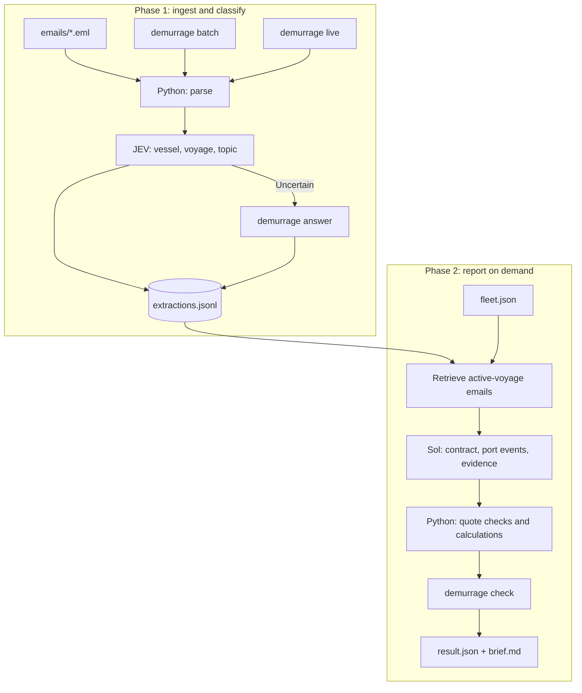

# Demurrage Pipeline

## Design, decisions and assumptions

**How is the pipeline structured?**

The pipeline has two phases: email ingestion/classification and on-demand voyage reporting. In Phase 1, `batch` deletes `extractions.jsonl` and previous answer files, then processes the full inbox. `live` processes a new `.eml` and appends one extraction record; the intended setup is a runner that calls it when an email arrives. `answer` records a human response when classification is uncertain and resumes processing only after the answer was provided. This feedback path was not thoroughly tested.

Python parses emails and JEV classifies vessel, voyage and topic. In Phase 2, the report command retrieves emails for the active voyage using `extractions.jsonl` and `fleet.json`. Sol (the Resolver) reconciles the contract and interprets port events and laytime evidence in one LLM step. Python checks the cited quotations and performs the arithmetic. The outputs are `result.json` and `brief.md`.

**Why did I choose JEV and Sol?**

JEV was chosen for its fit with classification and good initial performance. Sol was chosen for the more complex reconciliation across emails and contract terms. A taxonomy of extracted facts feeding explicit `ContractState` and `VoyageState` objects was considered, but would have required more design and testing. The single LLM resolution step was practical within the available time and flexible when the wording or data is unexpected.

**What assumptions did I make?**

The current context is about **11,322 tokens**. I assume the emails retrieved for an active vessel remain tractable for the LLM. I also assume emails for a vessel belong to the active voyage in `fleet.json`, if the vessel or voyage or port is are outside the itinerary in `fleet.json`, these are dropped. The report is generated on demand, rather than every time an email arrives; I assume a later UI or agent can call it as an API and use the output to reply to a specific question. Quoted/forwarded text is not separated, assuming it could be helpful for context. 

## How do I know the results are correct, and how good are they?

I test Python rules, use human input when JEV is uncertain, and require Sol to cite quotations that `demurrage check` validates against the source emails. I also manually shuffled the emails and checked that the output did not change. Automated tests mock JEV and compare against a hand-written result.

Important: the current setup was designed in order to create some guardrails, but it has it's limits, that with more time could be improved. The shuffle check was manual, and there is no golden set that re-runs hard cases to detect regressions after prompt or model changes. Exact quote matching proves that the text exists in the source, which is helpful for the user to double check where the decision came from, however there is no check that it supports the interpretation given to the quote. The human-feedback path is also under-tested.

## What does a run cost?

The current cost is approximately **$0.045 per call**.  The estimate may increase with larger email volumes, assuming 20 times the data per voyage and roughly linear cost growth, I estimate around **$1 per report run**. This cost is incurred when an operator requests a report, not every time an email arrives.

## What doesn't work yet, and what would I do with another week?

The laytime calculator supports reversible laytime only; non-reversible contracts return no amount. I would implement more fetures from the domain, create some synthetic data in order to test the models understanding better as well. 

The human-feedback workflow needs end-to-end testing. If the resolver is unsure, the voyage is marked incomplete, but there is no command to answer that question and recompute the report. JEV confidence is not saved, so adding confidence thresholds would require storing it or reclassifying emails.

With another week, I would test human feedback, save JEV confidence and tune prompts/thresholds; create a golden set of difficult emails; sample operator feedback and track performance on a dashboard; improve voyage matching using port and charterer (and potentially captain); and add non-reversible laytime and the rule for exceptions that stop once demurrage starts.

Time allocated for the project: ~12h, over one single day, would spread it better usually, but my week was very busy at work. 
Thank you for the time reviewing my proposal!
by Silvia Romanato